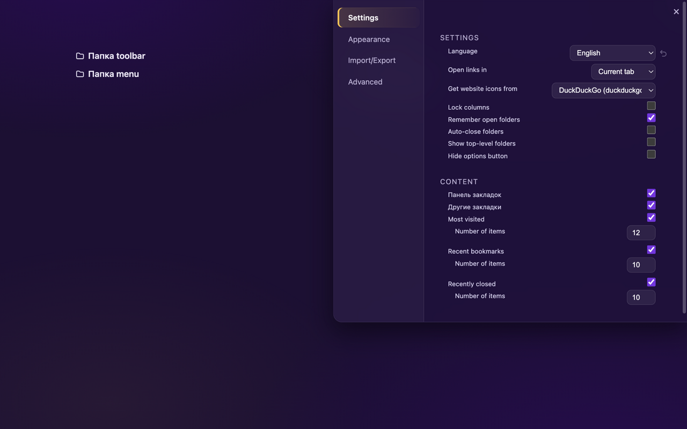

# Humble New Tab Page: Modern

A modern and stylish fork of the classic [Humble New Tab Page](https://github.com/ibillingsley/HumbleNewTabPage) extension for Firefox ([original on AMO](https://addons.mozilla.org/firefox/addon/humble-new-tab/)). The project is fully restyled to match the visual language of modern Firefox and firefox.com, moved to vector graphics, and extended with useful new settings — while keeping the original's speed, lightweight footprint and flexible column layout.



## ✨ What's different from the original (v1.26.1)

### Design (Firefox-inspired)

* **Gradient background** — dark purple (`#1e1035` / `#2b0b54`) with soft radial glows.
* **Fresh color palette** — lavender text with the signature yellow accent (`#ffc53d`) and purple highlights (`#7b33e6`).
* **Bookmark pills** — rounded hover rows with a translucent purple tint, a soft glow and a clean focus ring.
* **Vector (SVG) icons** — every legacy PNG icon (folders, clock, star, globe, etc.) is replaced with crisp SVG masks that automatically adapt to the current text color.
* **Restyled menus and settings** — context menus and the options panel are rebuilt as dark glass cards with `backdrop-filter` blur and highlighted active elements.
* **Light theme** — a full alternative "Firefox Light" theme is included (Appearance → Colors).

### Functionality

* **Favicon provider choice** — DuckDuckGo (the default), Yandex, Google, Favicon Kit, Qwant, direct `favicon.ico` loading, or no network at all. Broken icons automatically fall back to a vector globe.
* **English and Russian UI** with a language selector: Auto (browser language) / English / Russian.
* **"Recently closed" context menu** — quick access to History (`about:history`) and Clear browsing data (`about:preferences#privacy`).
* **Fixed-size options panel** — the panel no longer resizes when switching between sections; long sections scroll internally.
* **Standalone Gecko ID** (`humble-new-tab-modern@janlosk`) — can be installed alongside the original AMO version without conflicts.
* **Compatibility** — Firefox 134 and later (`strict_min_version: 134`).

Everything else works like the original: drag and drop folders into columns, customize fonts, colors, spacing and animation, import/export settings, custom CSS.

## 📦 Download and install

Grab a ready-to-install package from the [Releases](../../releases) page:
**`HumbleNewTabPageModern-2.0.0.xpi`**

### Temporary install (until Firefox restarts)

1. Clone this repository or download the sources.
2. Open `about:debugging#/runtime/this-firefox` in Firefox.
3. Click **Load Temporary Add-on…** and pick any file from the source folder (e.g. `manifest.json`).

### Permanent install

...

## 🛠️ Building from source

The extension sources are at the repository root (`manifest.json`, `newtab.html`, `newtab.css`, `newtab.js`, `icons/`). To package manually:

```sh
zip -r HumbleNewTabPageModern.xpi manifest.json newtab.html newtab.css newtab.js README.md privacy.md LICENSE_MIT.txt icons
```

The original upstream (including its Chrome-only variant) is available at [ibillingsley/HumbleNewTabPage](https://github.com/ibillingsley/HumbleNewTabPage) and in this repository's git history.

## 📋 Changelog

### Version 2.0.0 - October 10, 2026

- Modern redesign styled after firefox.com: dark purple gradient, yellow accent, rounded hover pills with glow
- Vector (SVG) icons replace legacy PNG icons, tinted to match the text color
- Restyled options panel, context menus and form controls (dark theme)
- Options panel keeps a fixed size when switching sections; long sections scroll internally
- Russian UI translation with a language selector: Auto (browser language) / English / Russian
- DuckDuckGo is the default favicon provider (Yandex, Google, Qwant, Favicon Kit, direct or none also available)
- "Recently closed" context menu: History (`about:history`) and Clear browsing data (`about:preferences#privacy`)
- Broken favicons fall back to a vector globe icon
- New "Firefox Light" color theme; "Default" is now the dark firefox.com look

For earlier versions see the [upstream changelog](https://github.com/ibillingsley/HumbleNewTabPage#changelog).

## 📄 License

Distributed under the same **MIT License** as the original project — see [LICENSE_MIT.txt](LICENSE_MIT.txt).
